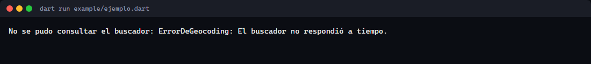

# direcciones_ar

<p>
  <a href="https://github.com/lucabaello1998/direcciones_ar/actions/workflows/ci.yml"></a>
  
  
  <a href="https://github.com/lucabaello1998/direcciones_ar/releases/latest"></a>
</p>

Autocompletado y geocodificación inversa de direcciones argentinas con
[Nominatim](https://nominatim.openstreetmap.org/) (OpenStreetMap). Sin API key.

- **Buscar**: `rivadavia 5000 caballito` → lista de direcciones con lat/lon.
- **Revertir**: tocás un punto del mapa → la dirección más cercana.
- **Cachea** y **espacia** las llamadas para respetar la política de uso del
  servicio público (1 request por segundo).
- **Distingue** "no hay resultados" (lista vacía) de "el servicio falló"
  (`ErrorDeGeocoding`), que es lo que permite decir "revisá tu conexión" en vez
  de "esa dirección no existe".



Salida real de `dart run example/ejemplo.dart "rivadavia 5000 caballito"` (en esta corrida el servicio no respondió a tiempo).

## Instalar

Todavía no está publicado en pub.dev. Como dependencia de git:

```yaml
dependencies:
  direcciones_ar:
    git:
      url: https://github.com/lucabaello1998/direcciones_ar.git
```

## Usar

```dart
import 'package:direcciones_ar/direcciones_ar.dart';

final cliente = ClienteNominatim(); // userAgent propio incluido

// Autocompletado
final opciones = await cliente.buscar('rivadavia 5000 caballito');
for (final opcion in opciones) {
  print('${opcion.direccionCorta} · ${opcion.detalle}');
  // Avenida Rivadavia 5000, Caballito · Caballito, Buenos Aires, Ciudad Autónoma de Buenos Aires, C1424CER, Argentina
}

// Geocodificación inversa
final direccion = await cliente.reversa(-34.6183831, -58.4362001);
print(direccion?.direccionCorta); // Avenida Rivadavia 5000, Caballito

cliente.cerrar();
```

Para probarlo sin escribir código, el ejemplo ejecutable hace una búsqueda y su
reversa contra el servicio real (necesita internet):

```bash
dart run example/ejemplo.dart "rivadavia 5000 caballito"
```

> **Sobre las consultas:** Nominatim busca texto libre, no direcciones
> estructuradas. Una altura que no existe en OpenStreetMap devuelve lista vacía
> (no un error), y una palabra que contradice al resto — `corrientes 1234
> caballito` — también. Si te interesa si hay resultados, es lista vacía; si el
> servicio falló, es `ErrorDeGeocoding`.

### En Flutter

El cliente es independiente de la UI: guardalo en un provider y usalo desde el
campo de texto. Para el debounce del tipeo, `Timer` de 500-700 ms alcanza; de más
no aporta porque las llamadas ya están espaciadas.

```dart
final clienteGeocodingProvider = Provider<ClienteNominatim>((ref) {
  final cliente = ClienteNominatim();
  ref.onDispose(cliente.cerrar);
  return cliente;
});
```

## Qué devuelve

`DireccionSugerida` trae los campos ya separados, que es la parte que suele
faltar en otros clientes:

| Campo | Ejemplo |
|---|---|
| `calle` / `numero` | `Italia` / `2274` |
| `barrio` | `Caballito` |
| `localidad` | `Ciudad Autónoma de Buenos Aires` |
| `provincia` / `codigoPostal` / `pais` | `Buenos Aires` / `1424` / `Argentina` |
| `calleYAltura` | `Italia 2274` |
| `direccionCorta` | `Italia 2274, Caballito` |
| `detalle` | `Caballito, Ciudad Autónoma de Buenos Aires, 1424, Argentina` |
| `etiqueta` | el `display_name` original |

`direccionCorta` prefiere el **barrio** antes que la localidad: en CABA la
localidad es "Ciudad Autónoma de Buenos Aires" para las 15 comunas, así que
mostrarla no distingue nada. Si el resultado no trae barrio, usa la localidad
(`Avenida Colón 100, Córdoba`).

`esUbicable` es `false` cuando el resultado no trae coordenadas, así se puede
descartar antes de mostrarlo.

## Configuración

```dart
ClienteNominatim(
  pais: 'ar',                                  // null para buscar en todo el mundo
  intervaloMinimo: const Duration(milliseconds: 1100),
  tiempoMaximo: const Duration(seconds: 8),
  cacheMaximo: 200,
  userAgent: 'mi_app/1.0 (+https://mi-app.com)',
);
```

## Uso responsable del servicio público

Nominatim es gratis y lo mantiene la comunidad. Si vas a producción con volumen:

1. Poné un `User-Agent` que identifique tu app y un contacto.
2. No bajes de 1 request por segundo (el default ya lo respeta).
3. Cacheá lo que puedas.
4. Si necesitás más volumen, usá una instancia propia o un proveedor pago
   (Google Places, Mapbox, Photon autohospedado).

Ver la [política de uso](https://operations.osmfoundation.org/policies/nominatim/).

## Tests y CI

```bash
dart pub get
dart format --output=none --set-exit-if-changed .   # lo mismo que corre el CI
dart analyze --fatal-infos
dart test                                            # 18 tests
```

Los tests usan `MockClient` de `package:http`: no pegan al servicio real, así que
corren sin internet y sin gastar el rate limit de Nominatim. El workflow
`.github/workflows/ci.yml` corre esos tres comandos en cada push y PR.

## Publicar en pub.dev

Todavía no está publicado. Para publicarlo:

```bash
# 1. subí la versión en pubspec.yaml y anotá el cambio en CHANGELOG.md
# 2. verificá que el paquete esté completo antes de subirlo
dart pub publish --dry-run
# 3. publicá (abre el navegador para autenticarte la primera vez)
dart pub publish
```

`--dry-run` es el paso que importa: avisa si falta el `CHANGELOG`, si el
`description` o el `README.md` no cumplen lo que pide pub.dev, o si se está por
subir algo que no debería (`.dart_tool/`, archivos enormes). Después del primer
publish, la dependencia de git del principio se puede reemplazar por:

```yaml
dependencies:
  direcciones_ar: ^0.2.0
```

## Licencia

MIT.
